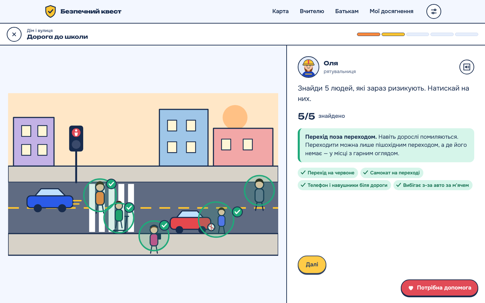
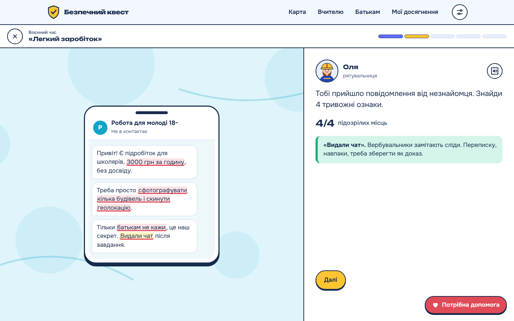
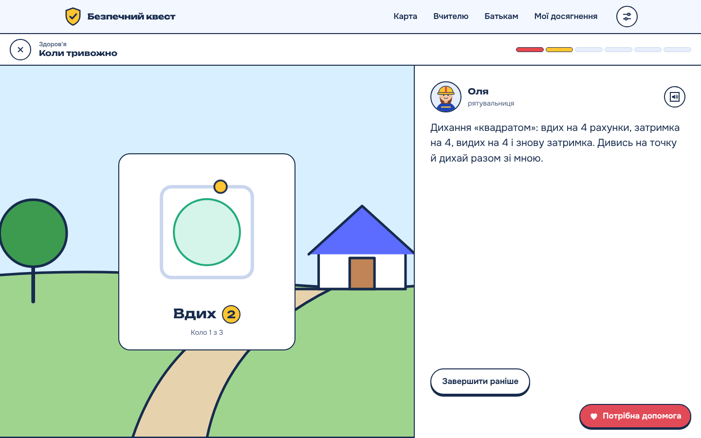
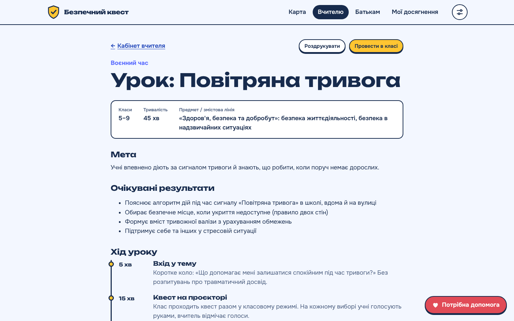

<div align="center">


# Безпечний квест

**Інтерактивні квести з безпеки для шкіл Нової української школи**

БЖД · безпека у воєнний час · кібербезпека · фінансова безпека · протидія булінгу · перша допомога

[](https://github.com/s1lect/bezpechnyi-kvest/actions/workflows/deploy.yml)
[](LICENSE)
[](LICENSE-CONTENT.md)

[**Відкрити сайт**](https://s1lect.github.io/bezpechnyi-kvest/) · [Кабінет вчителя](https://s1lect.github.io/bezpechnyi-kvest/#/teacher) ·
[Дорожня карта](docs/ROADMAP.md)

</div>


## Що це

«Безпечний квест» — вебплатформа, де учні тренують безпечну поведінку в ілюстрованих інтерактивних історіях, а вчителі отримують
готові уроки на 45 хвилин. Зміст спирається на модельні навчальні програми інтегрованого курсу **«Здоров'я, безпека та добробут»**
(соціальна і здоров'язбережувальна освітня галузь) і предмета **«Підприємництво і фінансова грамотність»**.

Учень не читає правила — він ухвалює рішення, помиляється без покарання, чує пояснення і пробує знову.

## Можливості

**Для учня**

- 13 квестів у шести тематичних «районах» міста.
- 8 типів завдань: вибір із поясненням, пошук небезпек на ілюстрації, сортування, тривожна валіза з лімітом ваги, пошук ознак обману
  в листуванні, тренажер ритму серцево-легеневої реанімації, кузня паролів, дихальна вправа «квадратом».
- Озвучення українською: у кожного персонажа свій голос.
- Значки за райони та сертифікат для друку.

**Для вчителя**

- Конспект уроку до кожного квесту: мета, очікувані результати, етапи на 40–45 хвилин, питання, домашнє завдання.
- Класний режим для проєктора: учні голосують руками, вчитель відмічає голоси й відкриває відповідь.
- QR-код, щоб учні пройшли квест на телефонах. Порядок варіантів однаковий на всіх пристроях.
- Таблиця відповідності очікуваним результатам НУШ і пам'ятка з травмочутливого ведення уроку.

**Для школи**

- Без реєстрації, реклами, трекерів і збору персональних даних. Прогрес зберігається лише на пристрої.
- Працює офлайн (PWA) — в укритті й під час блекауту.
- Статичний сайт: GitHub Pages, шкільний сервер або флешка.
- Відкритий код і відкритий зміст.

Кнопка **«Потрібна допомога»** на кожній сторінці відкриває перелік екстрених служб і безкоштовних гарячих ліній для дітей.

## Квести

| Район        | Квест                                         | Класи | Типи завдань                         |
| ------------ | --------------------------------------------- | ----- | ------------------------------------ |
| Дім і вулиця | Кухня без пожежі                              | 1–7   | пошук небезпек, вибір                |
| Дім і вулиця | Дорога до школи                               | 1–7   | пошук небезпек, вибір                |
| Стосунки     | Свідок (булінг і кібербулінг)                 | 5–9   | сортування, вибір                    |
| Стосунки     | Мої межі (тиск однолітків, «Я-повідомлення»)  | 5–9   | сортування, вибір                    |
| Інтернет     | Фішинг-детектив                               | 5–11  | підозрілий чат, кузня паролів, вибір |
| Інтернет     | Фейк чи факт (медіаграмотність, діпфейки)     | 6–11  | сортування, вибір                    |
| Воєнний час  | Повітряна тривога                             | 5–9   | вибір, тривожна валіза               |
| Воєнний час  | Знахідка біля дороги (мінна безпека)          | 3–9   | пошук небезпек, вибір                |
| Воєнний час  | «Легкий заробіток» (вербування в месенджерах) | 7–11  | підозрілий чат, вибір                |
| Гроші        | Дзвінок «з банку»                             | 6–11  | озвучений дзвінок, сортування, вибір |
| Гроші        | Пастка на маркетплейсі                        | 6–11  | підозрілий чат, вибір                |
| Здоров'я     | Ритм серця (СЛР)                              | 7–11  | вибір, тренажер ритму                |
| Здоров'я     | Коли тривожно (саморегуляція)                 | 3–11  | дихальна вправа, сортування, вибір   |

<table>
<tr>
<td></td>
<td></td>
</tr>
<tr>
<td></td>
<td></td>
</tr>
<tr>
<td></td>
<td></td>
</tr>
</table>

## Швидкий старт

Потрібен Node.js 20 або новіший.

```bash
git clone https://github.com/s1lect/bezpechnyi-kvest.git
cd bezpechnyi-kvest
npm install
npm run dev        # http://localhost:5173
```

| Команда           | Що робить                                             |
| ----------------- | ----------------------------------------------------- |
| `npm run dev`     | Сервер розробки з гарячим перезавантаженням           |
| `npm test`        | Модульні тести й автоматична перевірка змісту квестів |
| `npm run lint`    | Лінтер (oxlint)                                       |
| `npm run format`  | Форматування коду (Prettier)                          |
| `npm run build`   | Перевірка типів і production-збірка в `dist/`         |
| `npm run preview` | Перегляд зібраної версії                              |

Папку `dist/` можна скопіювати на будь-який вебсервер або відкрити з флешки: маршрутизація через `#`, тож серверні налаштування не
потрібні.

## Як влаштовано

```
src/
├── data/
│   ├── quests/          # квести як дані — додати квест можна без зміни рушія
│   ├── content.test.ts  # автоматична перевірка змісту всіх квестів
│   ├── worlds.ts        # райони міста й персонажі
│   └── hotlines.ts      # номери екстрених служб і гарячих ліній
├── engine/
│   ├── steps/           # 10 типів кроків, кожен в окремому файлі
│   ├── ui.tsx           # рамка сцени, діалог, відгук
│   ├── scoring.ts       # підрахунок балів
│   └── QuestPlayer.tsx  # вступ, проходження, результат
├── components/          # карта міста, ілюстрації сцен, портрети, налаштування, кнопка допомоги
├── pages/               # головна, райони, кабінет вчителя, конспекти, батькам, досягнення
└── lib/                 # чиста логіка з тестами, озвучення, звуки, прогрес, налаштування
```

**Стек:** React 19, TypeScript, Vite, React Router, vite-plugin-pwa, Vitest. Ілюстрації — власні SVG у коді, без растрових файлів.
Шрифти Unbounded та Onest підключені локально. Сторінки завантажуються окремими частинами, щоб головна відкривалася швидко.

**Якість.** TypeScript у строгому режимі, oxlint, Prettier і 85+ тестів. Тест змісту перевіряє кожен квест: у кожному питанні рівно
одна правильна відповідь, фрагменти чату справді є в повідомленнях, тривожну валізу можна зібрати, зони пошуку не перекриваються, урок
триває 40–45 хвилин, усі номери телефонів є в довіднику. CI запускає все це перед кожним деплоєм.

**Доступність.** Керування з клавіатури (цифри 1–3 для варіантів, пробіл для ритму), фокус переходить на нову ситуацію для екранних
читачів, контрастні кольори, повага до налаштування «зменшити рух», великий текст і спокійний режим без анімацій і звуків.

**Озвучення** працює через Web Speech API з українським голосом браузера. Найприродніше звучить у Microsoft Edge (голоси Polina та
Ostap) і Chrome на Android. Для професійного озвучення акторами досить додати до кроку поле `audio` зі шляхом до файлу — рушій програє
запис замість синтезу.

## Додати новий квест

Квест — це TypeScript-об'єкт із метаданими для вчителя й масивом кроків. Покрокова інструкція з прикладами всіх типів завдань — у
[docs/CONTENT_GUIDE.md](docs/CONTENT_GUIDE.md).

## Статус змісту

Це пілотна версія. Зміст підготовлено на основі відкритих рекомендацій ДСНС, МОЗ, НБУ та модельних програм МОН. **Перед офіційним
використанням** кожен квест має пройти фахове рецензування — рецензент вказаний у конспекті уроку (поле `reviewBy`). Номери гарячих
ліній варто звіряти перед кожним навчальним роком.

## Дорожня карта

План розвитку, етапи пілотування й подання на експертизу — у [docs/ROADMAP.md](docs/ROADMAP.md).

## Участь

Пропозиції квестів, виправлення змісту й код вітаються. Дивіться [CONTRIBUTING.md](CONTRIBUTING.md).

## Ліцензія

- Код — [MIT](LICENSE).
- Навчальний зміст (тексти квестів і конспекти) — [CC BY 4.0](LICENSE-CONTENT.md): можна використовувати й адаптувати із зазначенням
  авторства.
