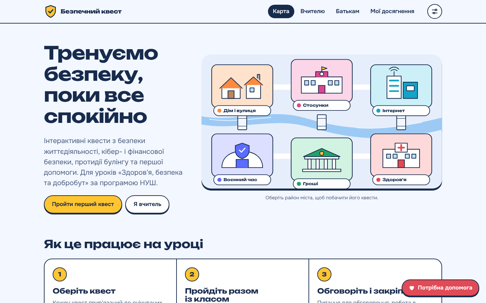
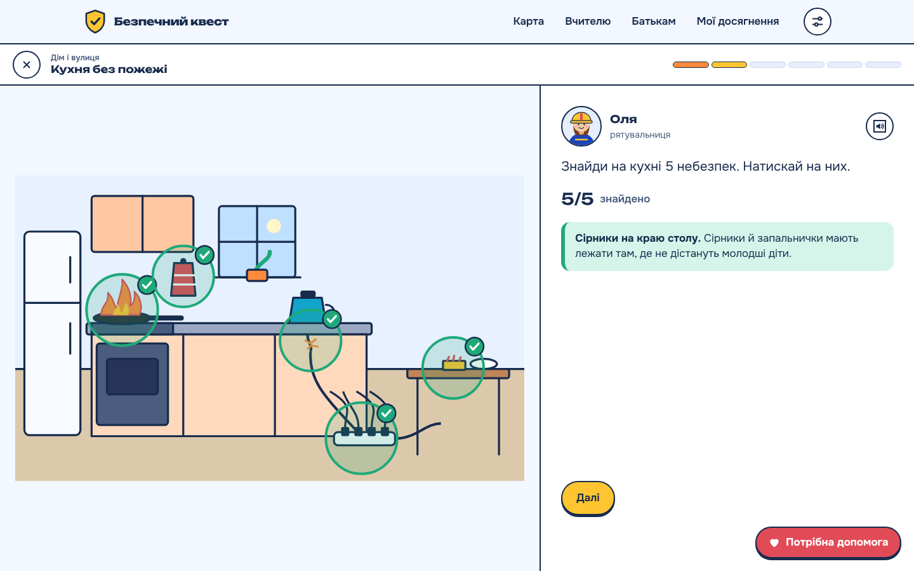
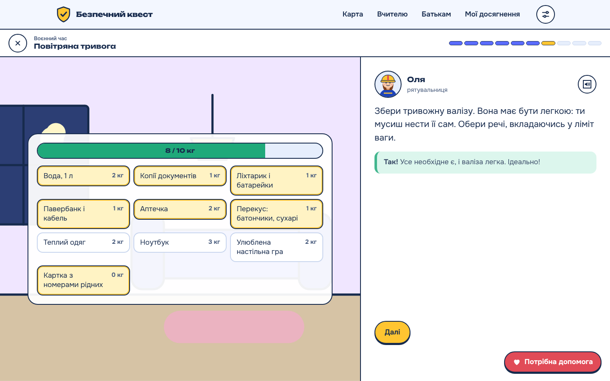
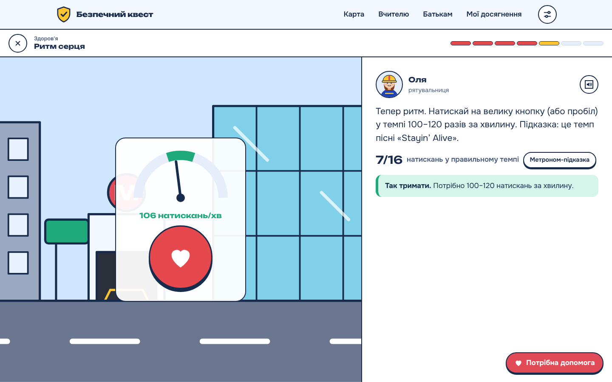

<div align="center">


# Безпечний квест

**Інтерактивні квести з безпеки для шкіл Нової української школи**

БЖД · безпека у воєнний час · кібербезпека · фінансова безпека · протидія булінгу · перша допомога

[](https://github.com/s1lect/bezpechnyi-kvest/actions/workflows/deploy.yml)
[](LICENSE)
[](LICENSE-CONTENT.md)

[**Відкрити сайт**](https://s1lect.github.io/bezpechnyi-kvest/) · [Кабінет вчителя](https://s1lect.github.io/bezpechnyi-kvest/#/teacher) · [Дорожня карта](docs/ROADMAP.md)

</div>



## Що це

«Безпечний квест» — вебплатформа, де учні тренують безпечну поведінку в ілюстрованих інтерактивних історіях, а вчителі отримують
готові уроки на 45 хвилин. Зміст спирається на модельні навчальні програми інтегрованого курсу **«Здоров'я, безпека та добробут»**
(соціальна і здоров'язбережувальна освітня галузь) і предмета **«Підприємництво і фінансова грамотність»**.

Учень не читає правила — він ухвалює рішення, помиляється без покарання, чує пояснення і пробує знову.

## Можливості

| Для учня | Для вчителя | Для школи |
| --- | --- | --- |
| 7 квестів у 6 тематичних «районах» міста | Конспект уроку до кожного квесту: мета, етапи, питання, домашнє завдання | Без реєстрації та збору персональних даних |
| Озвучення українською для кожного персонажа | Класний режим для проєктора з підрахунком голосів | Працює офлайн (PWA) — в укритті й під час блекауту |
| 7 типів завдань: вибір, пошук небезпек, сортування, тривожна валіза, підозрілий чат, тренажер ритму СЛР, кузня паролів | QR-код, щоб учні пройшли квест на телефонах | Статичний сайт: GitHub Pages, шкільний сервер або флешка |
| Значки за райони та сертифікат для друку | Таблиця відповідності очікуваним результатам НУШ | Без реклами й трекерів |
| Спокійний режим без анімацій і звуків | Пам'ятка з травмочутливого ведення уроку | Відкритий код і відкритий зміст |

Кнопка **«Потрібна допомога»** на кожній сторінці відкриває перелік екстрених служб і безкоштовних гарячих ліній для дітей.

## Квести пілотної версії

| Район | Квест | Класи | Типи завдань |
| --- | --- | --- | --- |
| Дім і вулиця | Кухня без пожежі | 1–7 | пошук небезпек, вибір |
| Воєнний час | Повітряна тривога | 5–9 | вибір, тривожна валіза |
| Воєнний час | Знахідка біля дороги (мінна безпека) | 3–9 | пошук небезпек, вибір |
| Інтернет | Фішинг-детектив | 5–11 | підозрілий чат, кузня паролів, вибір |
| Гроші | Дзвінок «з банку» | 6–11 | озвучений дзвінок, сортування, вибір |
| Стосунки | Свідок (булінг і кібербулінг) | 5–9 | сортування, вибір |
| Здоров'я | Ритм серця (СЛР) | 7–11 | вибір, тренажер ритму |

<table>
<tr>
<td></td>
<td></td>
</tr>
<tr>
<td></td>
<td></td>
</tr>
</table>

## Швидкий старт

Потрібен Node.js 20 або новіший.

```bash
git clone https://github.com/s1lect/bezpechnyi-kvest.git
cd bezpechnyi-kvest
npm install
npm run dev        # http://localhost:5173
```

| Команда | Що робить |
| --- | --- |
| `npm run dev` | Сервер розробки з гарячим перезавантаженням |
| `npm run build` | Перевірка типів і production-збірка в `dist/` |
| `npm run preview` | Перегляд зібраної версії |
| `npm run lint` | Лінтер (oxlint) |

Папку `dist/` можна скопіювати на будь-який вебсервер або відкрити з флешки: маршрутизація через `#`, тож серверні налаштування не
потрібні.

## Як влаштовано

```
src/
├── data/
│   ├── quests/        # квести як дані — додати квест можна без зміни рушія
│   ├── worlds.ts      # райони міста і персонажі
│   └── hotlines.ts    # номери екстрених служб і гарячих ліній
├── engine/            # рушій квестів: рамка сцени, 9 типів кроків, екран результату
├── components/        # карта міста, ілюстрації сцен, портрети, налаштування, кнопка допомоги
├── pages/             # головна, райони, кабінет вчителя, конспекти, батькам, досягнення
└── lib/               # озвучення, звуки, прогрес, налаштування
```

**Стек:** React 19, TypeScript, Vite, React Router, vite-plugin-pwa. Ілюстрації — власні SVG у коді, без растрових файлів.
Шрифти Unbounded та Onest підключені локально.

**Озвучення** працює через Web Speech API з українським голосом браузера. Найприродніше звучить у Microsoft Edge (голоси Polina та
Ostap) і Chrome на Android. Для професійного озвучення акторами достатньо додати до кроку поле `audio` з шляхом до файлу — рушій
програє запис замість синтезу.

## Додати новий квест

Квест — це TypeScript-об'єкт із метаданими для вчителя і масивом кроків. Покрокова інструкція з прикладами всіх типів завдань —
у [docs/CONTENT_GUIDE.md](docs/CONTENT_GUIDE.md).

## Статус змісту

Це пілотна версія. Зміст підготовлено на основі відкритих рекомендацій ДСНС, МОЗ, НБУ та модельних програм МОН. **Перед офіційним
використанням** кожен квест має пройти фахове рецензування — рецензент вказаний у конспекті уроку (поле `reviewBy`). Номери гарячих
ліній варто звіряти перед кожним навчальним роком.

## Дорожня карта

Повний план розвитку на 100 пунктів, етапи пілотування і подання на експертизу — у [docs/ROADMAP.md](docs/ROADMAP.md).

## Участь

Пропозиції квестів, виправлення змісту і код вітаються. Дивіться [CONTRIBUTING.md](CONTRIBUTING.md).

## Ліцензія

- Код — [MIT](LICENSE).
- Навчальний зміст (тексти квестів і конспекти) — [CC BY 4.0](LICENSE-CONTENT.md): можна використовувати й адаптувати із зазначенням
  авторства.
